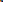

+++
id = "01M3YSDPE32AS6KFSDCEM8WJQ0"
title = "What protein is"
created = 2026-10-02T17:08:36Z
modified = 2026-10-02T17:08:36Z
+++

Protein is built from amino acids[^cite:01M3YSDPC79WYSW6CF1K75DVG1@44]. [^cite:01M3YSDPCK3YBNC4BTDKSPXH5H!narrative] measured how much of it Finnish adults eat.

# Kinds of protein

Complete proteins contain all nine essential amino acids[^cite:01M3YSDPCWY8X0Z3CWX6Q06WRD@para:3][^cite:01M3YSDPCQ5AF0C1JJEMMVRTA8]. The requirement is set per kilogram of body weight.[^cite:01M3YSDPCWY8X0Z3CWX6Q06WRD]
A line of its own, inside the same paragraph.

## Plant protein

See [[01M3YSDPE9SS9GJ65XYW05HGMC]] for what the body does with it. [^cite:01M3YSDPD05J9DNABE9WA00ZA0@time:1:04:22] shows it being measured, and [^cite:01M3YSDPD5DZR2ETXVTQ6XYN2W@time:12:30!narrative] talks it through.

Rated 5* online, which *is* not a source. #Not a heading either.
